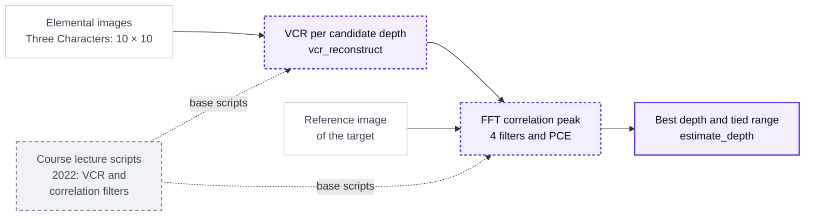

# Depth estimation with correlation filters and VCR

[](https://github.com/zoocasso/depth-estimation-using-vcr-algorithm-matlab/actions/workflows/ci.yml)

A 2022 course project, where my master's research started: an object's depth is estimated from integral images by reconstructing the scene at candidate depths and correlating each reconstruction with a reference image of the object.

**Write-up:** listed under other work on the site ([English](https://zoocasso.github.io/en/work/) · [한국어](https://zoocasso.github.io/work/)) · the research it led to: [origin point optimization](https://github.com/zoocasso/origin-point-optimization-vcr)


<sub>Frames of the 2022 nonuniform VCR sweep of the Three Characters scene, 400–1000 mm ([`results/nonuniform/`](results/nonuniform/)). An object is sharp only at its own depth. The 2022 estimates in the slides: front figure 660 mm (nonuniform) and 665–685 mm (fixed); back figure 845 mm and 820–845 mm.</sub>



<sub>Solid violet: added by me later · dashed violet: based on the course scripts, rewritten by me · grey dashed: the course's lecture materials · white: inputs.</sub>

## At a glance

| | |
| :--- | :--- |
| **What** | 2022 course project (3D Image Processing, spring 2022): object depth from integral images, where my master's research on VCR started |
| **My part** | 2022: ran the course scripts on the Three Characters set with small changes, and the depth experiments in the slides. Later: rewrote the scripts as functions and added the parts below |
| **Others** | The reconstruction scripts (fixed and nonuniform VCR) and the correlation-filter script came from the course's lecture materials |
| **Numbers** | 121 candidate depths give 35 different fixed-VCR reconstructions · read cache: 100 JPEG decodes instead of 15,600 · 2022 estimate for the front figure: 665–685 mm (fixed), 660 mm (nonuniform) |
| **Stack** | MATLAB, GNU Octave (tests and CI) |
| **Run · tests** | [Run](#run) · tests on synthetic scenes in GNU Octave, locally and on GitHub Actions |

## Key design decisions

**From the 2022 course project**

- **Reconstruct, then correlate.** VCR shifts every elemental image by the offset for a candidate depth and averages them; the object is sharp only at its own depth, so the depth where the reference image correlates best is the estimate. The VCR and correlation-filter scripts came from the lecture materials; my 2022 changes were small (running them on the Three Characters set, renaming variables, changing loop ranges, even image sizes, padding the reference with `padarray`) plus the depth experiments in the slides.

**Added in this repository**

- **The estimate is a range, not one depth.** Fixed VCR reuses one rounded step, so neighbouring depths often give the same reconstruction: on the example's 5 mm grid, 121 depths give only 35 different reconstructions, up to 11 in a row. `estimate_depth` returns every depth tied with the best one, and a depth whose offsets equal the previous one's is not reconstructed again.
- **Each image is decoded once.** With the read cache on, the example decodes 100 JPEGs instead of 15,600 (156 reconstructions × 100 images), at the cost of about 1.8 GB in memory.
- **Scores that can be compared.** Every correlation peak is divided by the reference's own peak, and the peak-to-correlation energy (PCE), which does not change with the scene's brightness, is returned with it.
- **Tested where the answer is known.** Synthetic scenes with a target at a known depth, which both methods must recover (fixed VCR as a range), run in GNU Octave on GitHub Actions.

## Run

```matlab
example_three_characters   % needs the data set in data/Three_Characters (not in the repository)
```

Tests use synthetic scenes, including a target whose true depth the estimate has to recover with both methods (with fixed VCR, as a range of tied depths). They run in GNU Octave, locally and on GitHub Actions; the code is written for MATLAB as well, but has not been run in MATLAB.

```bash
octave --eval "addpath(pwd); addpath(fullfile(pwd, 'tests')); run_tests"
```

## Results

[`results/fixed/`](results/fixed/) and [`results/nonuniform/`](results/nonuniform/) hold the 2022 reconstruction sweeps as videos: the Three Characters scene (3008 × 2000 px per image, 400–1000 mm) and a car scene at two resolutions (3072 × 2048 and 1536 × 1024 px, 200–500 mm). The slides are in [`docs/slides.pdf`](docs/slides.pdf); they give the fixed-VCR estimates as ranges (for example 665–685 mm for the first target) and the nonuniform ones as single depths (660 mm).

<details>
<summary><b>How it works, file by file</b></summary>

| File | Step |
|---|---|
| [`vcr_shifts.m`](vcr_shifts.m) | Pixel offset of every elemental image at a depth $z$. The ideal shift between neighbours is $S = N f p / (c z)$, but images sit on whole pixels: **fixed** VCR reuses one rounded step, $k \cdot \mathrm{round}(S)$, so the error grows with $k$; **nonuniform** VCR rounds each image, $\mathrm{round}(kS)$. |
| [`vcr_reconstruct.m`](vcr_reconstruct.m) | Places the images at those offsets and averages the overlaps. Images are read one at a time, so a 10 × 10 set of 3008 × 2000 images does not have to fit in memory unless the reader's cache is on. |
| [`correlation_peaks.m`](correlation_peaks.m) | Correlation peak of a reference target in a reconstruction, by FFT, for four filters: linear (matched) filter, phase-only filter $R^{*}/\lvert R\rvert$, phase correlation (the 2022 code's "phase-only filter", which keeps only the phase difference) and nonlinear filter. Each peak is divided by the reference's own peak, so it is 1 when the scene is the reference, but except for phase correlation (at most 1, independent of brightness) it is not bounded by 1 and grows with the scene's brightness: a scene twice as bright gives a linear peak of 2. The peak-to-correlation energy (PCE), also returned, does not change when the scene is multiplied by a constant. |
| [`estimate_depth.m`](estimate_depth.m) | Reconstructs at every candidate depth and returns the depth with the highest score and every depth tied with it. Neighbouring depths often round to the same offsets and give the same reconstruction, so the estimate is a range: with fixed VCR on the example's 5 mm grid, the 121 depths give only 35 different reconstructions, up to 11 in a row. A depth whose offsets equal the previous depth's is not reconstructed again, so with sorted depths every repeat is skipped. |
| [`ei_reader.m`](ei_reader.m) | Reads elemental image files. With the cache on, each file is decoded once instead of once per reconstruction: the example decodes 100 JPEGs instead of 15,600 (156 reconstructions × 100 images) and keeps them in memory, about 1.8 GB as uint8. |

</details>

---

<sub>This code is a 2026 cleanup and rewrite of the 2022 course project, so the commits are dated 2026.</sub>
