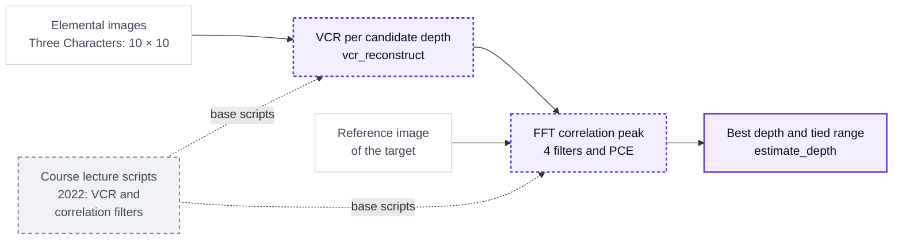

# Depth estimation with correlation filters and VCR

[](https://github.com/zoocasso/depth-estimation-using-vcr-algorithm-matlab/actions/workflows/ci.yml)

A 2022 course project: an object's depth is estimated from integral images by reconstructing the scene at candidate depths and correlating each reconstruction with a reference image.<br>
2022년 수업 프로젝트입니다. 후보 깊이마다 장면을 재구성하고 기준 영상과의 상관을 구해 물체의 깊이를 추정합니다.



<sub>Solid violet: added by me later · dashed violet: based on the course scripts, rewritten by me · grey dashed: the course's lecture materials · white: inputs.<br>
보라 실선: 나중에 제가 더한 부분 · 보라 점선: 수업 스크립트를 바탕으로 제가 다시 쓴 부분 · 회색 점선: 수업 강의자료 · 흰색: 입력.</sub>

[English](#english) · [한국어](#한국어)

## English

| At a glance | |
| :--- | :--- |
| **What** | 2022 course project (3D Image Processing, spring 2022): object depth from integral images, where my master's research on VCR started |
| **My part** | 2022: ran the course scripts on the Three Characters set with small changes, and the depth experiments in the slides. Later: rewrote the scripts as functions and added the parts below |
| **Others** | The reconstruction scripts (fixed and nonuniform VCR) and the correlation-filter script came from the course's lecture materials |
| **Numbers** | 121 candidate depths give 35 different fixed-VCR reconstructions · read cache: 100 JPEG decodes instead of 15,600 · 2022 estimate for the first target: 665–685 mm (fixed), 660 mm (nonuniform) |
| **Stack** | MATLAB, GNU Octave (tests and CI) |
| **Run · tests** | [Run](#run) · tests on synthetic scenes in GNU Octave, locally and on GitHub Actions |
| **Write-up** | listed under other work on [zoocasso.github.io/en/work](https://zoocasso.github.io/en/work/) |

A 2022 course project in MATLAB: find how far an object is from an integral-imaging camera array, using only the images. The scene is reconstructed at many depths with volumetric computational reconstruction (VCR); the object is sharp only at its own depth, so the depth where a reference image of the object correlates best is its estimated depth. This is where my master's research on VCR started ([origin point optimization](https://github.com/zoocasso/origin-point-optimization-vcr)).

The reconstructions in [`results/`](results/) are from the 2022 runs.

The reconstruction scripts (fixed and nonuniform VCR) and the correlation-filter script came from the lecture materials of the course (3D Image Processing, spring 2022). My 2022 changes were small: running them on the Three Characters set, renaming variables, changing loop ranges, making image sizes even and padding the reference with padarray, plus the depth experiments in the slides. Later I turned the scripts into functions and added the search over all depths, tied-depth ranges, the classic phase-only filter, PCE, the read cache and the tests.

### How it works

| File | Step |
|---|---|
| [`vcr_shifts.m`](vcr_shifts.m) | Pixel offset of every elemental image at a depth $z$. The ideal shift between neighbours is $S = N f p / (c z)$, but images sit on whole pixels: **fixed** VCR reuses one rounded step, $k \cdot \mathrm{round}(S)$, so the error grows with $k$; **nonuniform** VCR rounds each image, $\mathrm{round}(kS)$. |
| [`vcr_reconstruct.m`](vcr_reconstruct.m) | Places the images at those offsets and averages the overlaps. Images are read one at a time, so a 10 × 10 set of 3008 × 2000 images does not have to fit in memory unless the reader's cache is on. |
| [`correlation_peaks.m`](correlation_peaks.m) | Correlation peak of a reference target in a reconstruction, by FFT, for four filters: linear (matched) filter, phase-only filter $R^{*}/\lvert R\rvert$, phase correlation (the 2022 code's "phase-only filter", which keeps only the phase difference) and nonlinear filter. Each peak is divided by the reference's own peak, so it is 1 when the scene is the reference, but except for phase correlation (at most 1, independent of brightness) it is not bounded by 1 and grows with the scene's brightness: a scene twice as bright gives a linear peak of 2. The peak-to-correlation energy (PCE), also returned, does not change when the scene is multiplied by a constant. |
| [`estimate_depth.m`](estimate_depth.m) | Reconstructs at every candidate depth and returns the depth with the highest score and every depth tied with it. Neighbouring depths often round to the same offsets and give the same reconstruction, so the estimate is a range: with fixed VCR on the example's 5 mm grid, the 121 depths give only 35 different reconstructions, up to 11 in a row. A depth whose offsets equal the previous depth's is not reconstructed again, so with sorted depths every repeat is skipped. |
| [`ei_reader.m`](ei_reader.m) | Reads elemental image files. With the cache on, each file is decoded once instead of once per reconstruction: the example decodes 100 JPEGs instead of 15,600 (156 reconstructions × 100 images) and keeps them in memory, about 1.8 GB as uint8. |

### Run

```matlab
example_three_characters   % needs the data set in data/Three_Characters (not in the repository)
```

Tests use synthetic scenes, including a target whose true depth the estimate has to recover with both methods (with fixed VCR, as a range of tied depths). They run in GNU Octave, locally and on GitHub Actions; the code is written for MATLAB as well, but has not been run in MATLAB.

```bash
octave --eval "addpath(pwd); addpath(fullfile(pwd, 'tests')); run_tests"
```

### Results

[`results/fixed/`](results/fixed/) and [`results/nonuniform/`](results/nonuniform/) hold the 2022 reconstruction sweeps as videos: the Three Characters scene (3008 × 2000 px per image, 400–1000 mm) and a car scene at two resolutions (3072 × 2048 and 1536 × 1024 px, 200–500 mm). The slides are in [`docs/slides.pdf`](docs/slides.pdf); they give the fixed-VCR estimates as ranges (for example 665–685 mm for the first target) and the nonuniform ones as single depths (660 mm).

## 한국어

| 한눈에 보기 | |
| :--- | :--- |
| **무엇** | 2022년 수업 프로젝트(3차원영상처리, 2022년 1학기): 집적 영상으로 물체의 깊이 추정. 지금 석사 연구의 출발점 |
| **제가 한 일** | 2022년: 수업 스크립트를 Three Characters 데이터에 조금 고쳐 적용하고 슬라이드의 깊이 실험. 이후: 스크립트를 함수로 다시 쓰고 아래 기능을 더함 |
| **다른 사람** | 재구성 스크립트(fixed·nonuniform VCR)와 상관 필터 스크립트는 수업 강의자료 |
| **수치** | 후보 깊이 121개에서 fixed VCR 재구성은 35가지 · 읽기 캐시로 JPEG 디코딩 15,600번 → 100번 · 2022년 첫 번째 대상 추정: 665–685 mm(fixed), 660 mm(nonuniform) |
| **기술** | MATLAB, GNU Octave(테스트·CI) |
| **실행·테스트** | [Run](#run) · 합성 장면 테스트를 GNU Octave로 로컬과 GitHub Actions에서 실행 |
| **상세** | [zoocasso.github.io/work](https://zoocasso.github.io/work/)의 기타 작업 목록 |

2022년 수업 프로젝트(MATLAB)입니다. 집적 영상 카메라 배열로 찍은 영상만으로 물체까지의 거리를 구합니다. 체적 컴퓨터 재생(VCR)으로 여러 깊이에서 장면을 재구성하면 물체는 자기 깊이에서만 선명해지므로, 물체의 기준 영상과 상관이 가장 높은 깊이를 추정 깊이로 정합니다. 지금 석사 연구([원점 최적화](https://github.com/zoocasso/origin-point-optimization-vcr))의 출발점입니다.

[`results/`](results/)의 재구성 결과는 2022년에 돌린 것입니다.

재구성 스크립트(fixed·nonuniform VCR)와 상관 필터 스크립트는 수업(3차원영상처리, 2022년 1학기) 강의자료에서 왔습니다. 2022년에 제가 바꾼 것은 작습니다: Three Characters 데이터에 적용, 변수명 변경, 반복 범위 변경, 영상 크기를 짝수로 맞추고 padarray로 기준 영상 패딩, 그리고 슬라이드의 깊이 실험입니다. 이후 함수로 다시 쓰면서 전체 깊이 탐색, 동점 깊이 범위, 고전 위상 전용 필터, PCE, 읽기 캐시, 테스트를 더했습니다.

- **`vcr_shifts.m`**: 깊이별 요소 영상 이동량. fixed VCR은 반올림한 한 걸음을 반복하고(오차가 k에 비례해 커짐), nonuniform VCR은 영상마다 따로 반올림합니다.
- **`vcr_reconstruct.m`**: 이동한 영상을 겹쳐 평균합니다. 영상을 한 장씩 읽어서, 읽기 캐시를 켜지 않으면 3008 × 2000 영상 100장을 메모리에 한꺼번에 올리지 않습니다.
- **`correlation_peaks.m`**: FFT로 선형 상관 필터, 위상 전용 필터($R^{*}/\lvert R\rvert$), 위상 상관(2022년 코드에서 "위상 전용 필터"라고 부른 것으로, 위상 차이만 남김), 비선형 필터의 피크를 구하고 기준 영상의 자기상관 피크로 나눕니다. 장면이 기준 영상과 같으면 1이지만, 위상 상관(1 이하, 밝기와 무관)을 빼면 1을 넘을 수 있고 장면이 밝을수록 커집니다(두 배 밝으면 선형 피크가 2). 함께 돌려주는 PCE(peak-to-correlation energy)는 장면에 상수를 곱해도 변하지 않습니다.
- **`estimate_depth.m`**: 후보 깊이마다 재구성해 점수가 가장 높은 깊이와, 그와 같은 점수를 낸 깊이 전부를 돌려줍니다. 이웃한 깊이들이 같은 정수 이동량으로 반올림되면 재구성이 똑같아지므로 추정 결과는 범위입니다. 예제의 5 mm 간격 121개 깊이에서 fixed VCR의 재구성은 35가지뿐이고, 최대 11개 깊이가 연달아 같습니다. 이동량이 바로 앞 깊이와 같으면 다시 재구성하지 않으므로, 깊이를 정렬해 넘기면 반복되는 이동량은 모두 건너뜁니다.
- **`ei_reader.m`**: 요소 영상 파일을 읽습니다. 캐시를 켜면 파일마다 한 번만 디코딩해, 예제에서 JPEG 디코딩이 15,600번(재구성 156번 × 영상 100장)에서 100번으로 줄어드는 대신 약 1.8 GB(uint8)를 메모리에 둡니다.
- **테스트**: 합성 장면으로 참 깊이를 찾는지(fixed VCR은 동점 깊이 범위로) 확인합니다. GNU Octave에서 로컬과 GitHub Actions로 돌리며, MATLAB용으로도 작성했지만 MATLAB에서는 돌려 보지 않았습니다.

---

<sub>This code is a 2026 cleanup and rewrite of the 2022 course project, so the commits are dated 2026.<br>
이 코드는 2022년 수업 프로젝트를 2026년에 정리해 다시 쓴 것이라 커밋 날짜가 2026년입니다.</sub>
